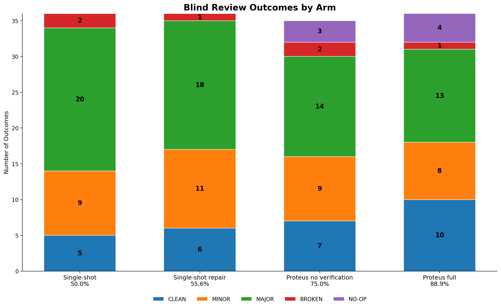
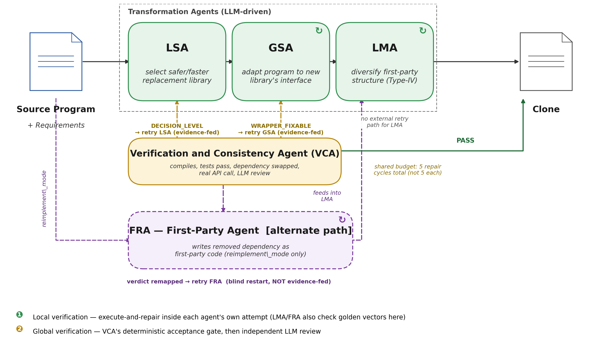
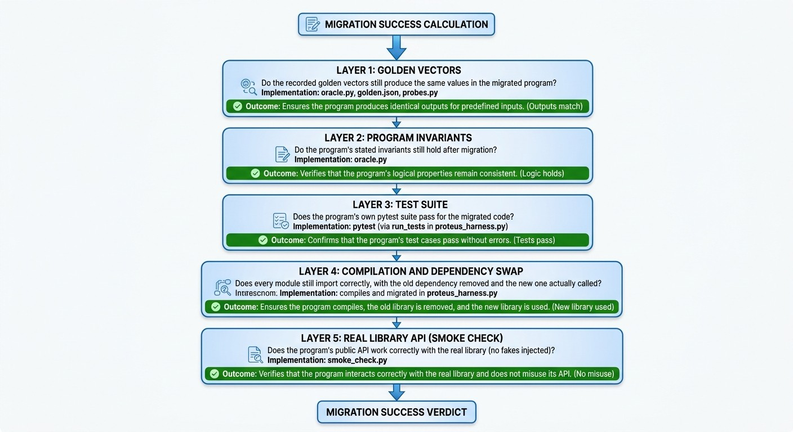
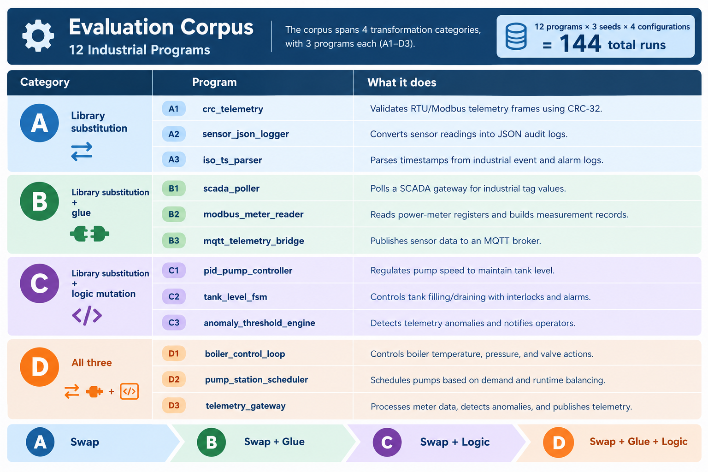
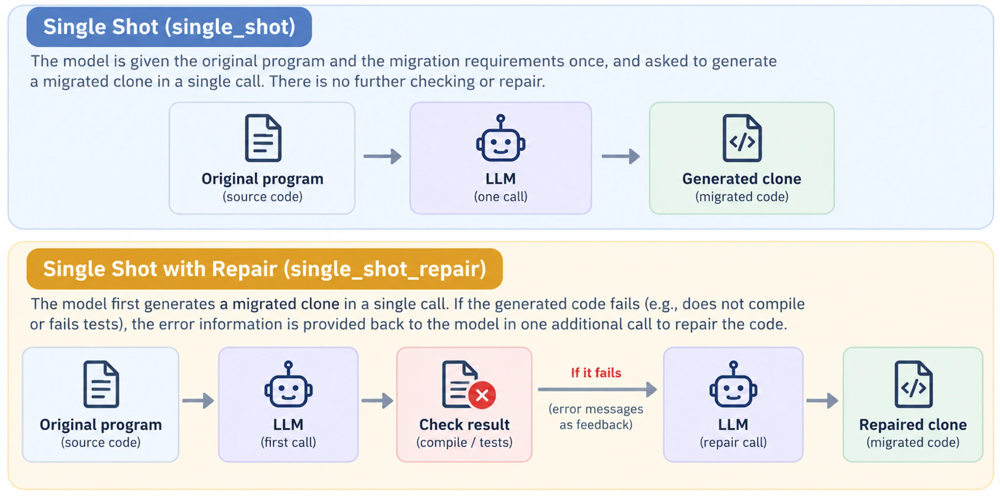

# Proteus: Constructing Semantically Equivalent Program Clones using LLMs and Execution Traces

**Best Student Paper and Presentation Award, DESSERT 2026** (16th Dependable Systems, Services and Technologies, Corfu, Greece, October 2-4, 2026)

Benita Magdalene Kingsley Prince and Ioannis Agadakos, School of Computing, Montclair State University

Proteus is a multi-agent system that rewrites a program so it behaves exactly as before while using a different library, and then checks that claim by running code instead of trusting the model. It targets industrial measurement-and-control software, where "it looks right" is not good enough.

> **Naming.** Proteus is the name of the system in the paper. This repository is the AXIOM codebase it was built in: the Python package is `smart_loader/`, the CLI is `axiom`, and the evaluated configurations are called `proteus_full` and `proteus_no_verif` in the code and the results.

## Results at a glance



*All 144 generated clones, classified by an independent blind LLM reviewer. The percentage under each bar is that configuration's deterministic migration success.*

| Configuration | Migration success | Judged clean | Judged major or broken | Pipeline cost (36 runs) |
|---|---|---|---|---|
| Single-shot LLM | 18/36 (50.0%) | 5 | 22 | $0.92 |
| Single-shot + one repair call | 20/36 (55.6%) | 6 | 19 | $1.49 |
| Proteus, verification off | 27/36 (75.0%) | 7 | 16 | $7.00 |
| **Proteus (full)** | **32/36 (88.9%)** | **10** | **14** | $15.65 |

- **Verification separates success from a plausible-looking failure.** Adding agents and then verification raises migration success from 50.0% to 75.0% to 88.9%.
- **Failures are safe.** All 4 non-successes in the full system are untouched originals that the verifier reverted to; none shipped a clone that failed the oracle.
- **Automated acceptance is necessary, not sufficient.** The blind reviewer still finds real defects in clones that pass every deterministic check, full Proteus included.
- **It is not free.** About 33 times the tokens and 17 times the dollar cost of the plain baseline across the study (a median run makes 11 LLM calls against 1).

With 12 programs and 3 seeds, migration success is the one comparison with a gap wide enough to trust; the other comparisons are directional.

## The problem

Industrial control software estimates physical measurements and drives pumps, boilers and telemetry gateways. Stuxnet showed that malware can physically damage plants by hijacking the controllers that run them (BBC News, 2010; CBS News/CNET, 2012), so when a dependency in that code is vulnerable or unmaintained, replacing it has to preserve behavior exactly. A tiny example:

```python
# Before: standard library
import zlib

def crc32(payload):
    return zlib.crc32(payload) & 0xFFFFFFFF
```

```python
# After: fastcrc
import fastcrc

def crc32(payload):
    return fastcrc.crc32.iso_hdlc(payload) & 0xFFFFFFFF
```

Trivial here, but the standard is the same everywhere: identical output on every input we tested, verified against both libraries rather than assumed.

## How Proteus works



Not one prompt, but a pipeline of agents, each owning one kind of change and its own execute-and-repair loop:

| Agent | Role | Where in the code |
|---|---|---|
| **LSA**, Library-Substitution Agent | Picks the replacement library from benchmark and vulnerability evidence | `resolver_agent.py`, `security_agent.py`, `profiler_agent.py`, `axiom_agent.py` |
| **GSA**, Glue-Synthesis Agent | Writes the adapter so call sites do not have to change | `connector_agent.py` |
| **LMA**, Logic-Mutation Agent | Rewrites first-party logic into structurally different, behaviorally equivalent code | `logic_substitution_agent.py`, `smart_loader/isomorph/` |
| **FRA**, First-Party Agent | When there is no library to substitute, reimplements the removed dependency as first-party code | `first_party_agent.py` |
| **VCA**, Verification and Consistency Agent | Deterministic acceptance gate, then an independent LLM review; routes failures back | `verifier_agent.py`, `migration_completeness.py` |

All agent code lives in `smart_loader/agents/`; the exact wiring is in `smart_loader/core/graph.py`.

- **Local verification.** Each agent checks its own attempt, and the LMA and FRA also check candidates against recorded golden vectors in that loop.
- **Global verification.** The VCA gate asks whether the clone compiles, its tests pass, the dependency is really swapped, and a real API call works. An independent LLM review follows.
- **Routing.** A decision-level failure goes back to the LSA and a wrapper-level bug back to the GSA, with the failure evidence attached, all from one shared budget of five repair cycles. The LMA has no external retry path, and the FRA restarts blind.
- **Audit trail.** Every substitution and mutation is recorded and attributable to the agent that made it (`axiom_logs/`), because diversification is dual-use.

## How success is measured

Exactly two checks decide whether a clone is valid.

**Check 1: migration success (deterministic).**



A clone must clear all three parts:

1. It compiles and its full existing test suite passes. That alone proves little, because every subject's tests pass before migration too.
2. A five-layer oracle: imports, recorded golden vectors, program invariants, the program's own tests, and a live smoke check that exercises its API against the real library with nothing faked.
3. It is a real migration: the source genuinely changed and the old dependency is verifiably gone, so an untouched file cannot pass.

The implementation numbers these layers differently; see [`equivalence/README.md`](equivalence/README.md) for the checkers and `migration_ok()` in [`smart_loader/eval/proteus_harness.py`](smart_loader/eval/proteus_harness.py) for the verdict itself.

**Check 2: the blind LLM judge.** Every subject injects a fake client for testing, so the code that actually calls the new library often never runs under test. A second model, `claude-opus-5` at temperature 0 (stronger than, and different from, the `claude-sonnet-5` that wrote the clone), reads the real source and judges behavior only. Every system-identifying marker is stripped and the batch aborts if one survives, so the reviewer never learns which configuration produced a clone. The worst finding wins:

| Verdict | Meaning |
|---|---|
| `BROKEN` | fails on ordinary input |
| `MAJOR` | wrong on a case the original handled |
| `MINOR` | a real difference, edge case only |
| `CLEAN` | no findings at all |
| `NO-OP` | never migrated: byte-identical, or still importing the removed dependency |

## The evaluation corpus



Twelve industrial programs, three in each of four categories, times 3 seeds times 4 configurations is 144 runs. Each program ships its own pytest suite; external I/O is dependency-injected. The programs are in [`corpus/`](corpus/).

| Category | Demand | Programs (library swap) |
|---|---|---|
| **A** | swap | `crc_telemetry` (zlib to fastcrc), `sensor_json_logger` (json to ujson), `iso_ts_parser` (datetime to ciso8601) |
| **B** | swap + glue | `scada_poller` (requests to httpx), `modbus_meter_reader` (pymodbus to minimalmodbus), `mqtt_telemetry_bridge` (paho-mqtt to aiomqtt) |
| **C** | swap + logic mutation | `pid_pump_controller` (simple-pid to in-house), `tank_level_fsm` (transitions to hand-rolled FSM), `anomaly_threshold_engine` (smtplib notifier to apprise) |
| **D** | all three | `boiler_control_loop` (pymodbus to minimalmodbus), `pump_station_scheduler` (requests to httpx), `telemetry_gateway` (paho-mqtt to aiomqtt) |

The replacement library is never named to any configuration; each must choose its own. Two programs (B2 and D1) declare a target that cannot be satisfied as stated (a serial-only library for a TCP client) and are kept as negative controls.

## The four configurations



| `--config` | What it is |
|---|---|
| `single_shot` | One prompt; whatever comes back is the clone. No agents, no checking, no repair. |
| `single_shot_repair` | The same call, then verification; on failure, exactly one more call with the failure evidence fed back. |
| `proteus_no_verif` | The agents run with the VCA and the equivalence-oracle gates switched off (the ablation). |
| `proteus_full` | The full system. |

All four are scored by the same code (`smart_loader/eval/proteus_harness.py`), so a difference between arms cannot come from the scoring.

## Limitations

- **Small sample.** 12 programs and 3 seeds are enough for the migration-success comparison, not for most others.
- **One generator and one judge model.** Everything uses `claude-sonnet-5` (generation) and `claude-opus-5` (judging).
- **Python stands in for PLC languages.** Real controllers are programmed in IEC 61131-3 languages.
- **Source-level equivalence.** The oracle checks recorded behavior, not timing or plant dynamics.
- **Residual defects.** The blind judge finds real defects in clones that pass every deterministic check.
- **One blind retry path.** The FRA restarts from scratch on rejection, without the failure evidence the other agents receive.

Future work: real PLC languages, an industrial-control-system simulator, attack-surface studies in both directions (does an exploit still land on a diversified clone, and is the agent pipeline itself a new target), and a larger corpus.

## Repository layout

| Path | Contents |
|---|---|
| `smart_loader/` | The pipeline: `agents/`, `core/graph.py` (wiring), `eval/proteus_harness.py` (scoring), `isomorph/` (logic-mutation search) |
| `equivalence/` | The deterministic checkers and recorded golden vectors; see its README |
| `corpus/` | The 12 evaluation programs, with their tests |
| `run_single_shot.py`, `run_single_shot_repair.py`, `run_axiom_arms.py` | Runners for the four configurations |
| `judge_clones.py` | The blind LLM judge (`judge_cache.jsonl` is its cache) |
| `results_fin_final.csv` | The 144-run results table behind every number in the paper |
| `make_final_figures.py` | Regenerates the figures in `paper/figs/` from the CSV |
| `ablation_study.xlsx` | Drop-one ablation of each success condition, why each failing run failed, and per-stage retry counts |
| `paper/` | LaTeX sources (`REVISED/`), figures, and the slides |
| `final_v4/`, `final_v5/`, `clones_*` | Generated clones from the experiment runs; the exact 144 are identified by `clone_sha` in the CSV |
| `ics_corpus/` | An earlier demo corpus used while developing the LMA; not part of the 144 runs |
| `tests/` | Unit tests |
| `docs/` | Design notes, and the previous README as `README_AXIOM_v2.md` |

`results_fin_final.csv` is the merged table used in the paper; the other `results_*.csv` files are intermediate runs.

## Reproducing the results

Tested with Python 3.12. Run everything from the repository root.

```bash
pip install -e .
pip install pytest
```

Put `ANTHROPIC_API_KEY=...` in a `.env` file at the repository root (it is gitignored; never commit it). Each runner appends rows to a results CSV (`--csv`) and saves clones (`--clone-dir`):

```bash
python3 run_single_shot.py        --corpus corpus --llm claude --model claude-sonnet-5 --runs 3
python3 run_single_shot_repair.py --corpus corpus --llm claude --model claude-sonnet-5 --runs 3
python3 run_axiom_arms.py         --corpus corpus --config proteus_no_verif --llm claude --model claude-sonnet-5 --runs 3
python3 run_axiom_arms.py         --corpus corpus --config proteus_full     --llm claude --model claude-sonnet-5 --runs 3
python3 judge_clones.py           --csv <your results csv> --corpus corpus --llm claude --model claude-opus-5
```

Run any script with `--help` for the full options (`--program` to run one program, `--dry-run` to preview). In our study the pipeline API cost was about $25 for all 144 runs, excluding the judge.

To regenerate the figures from the shipped results, with no API calls:

```bash
python3 make_final_figures.py
```

## Citation

Benita Magdalene Kingsley Prince and Ioannis Agadakos. "Proteus: Constructing Semantically Equivalent Program Clones using LLMs and Execution Traces." 16th Dependable Systems, Services and Technologies Conference (DESSERT 2026), Corfu, Greece, October 2-4, 2026.

## Earlier work

This codebase began as AXIOM v2, a multi-agent loader for Python library migration evaluated against PyMigBench. That README is preserved in [`docs/README_AXIOM_v2.md`](docs/README_AXIOM_v2.md).
